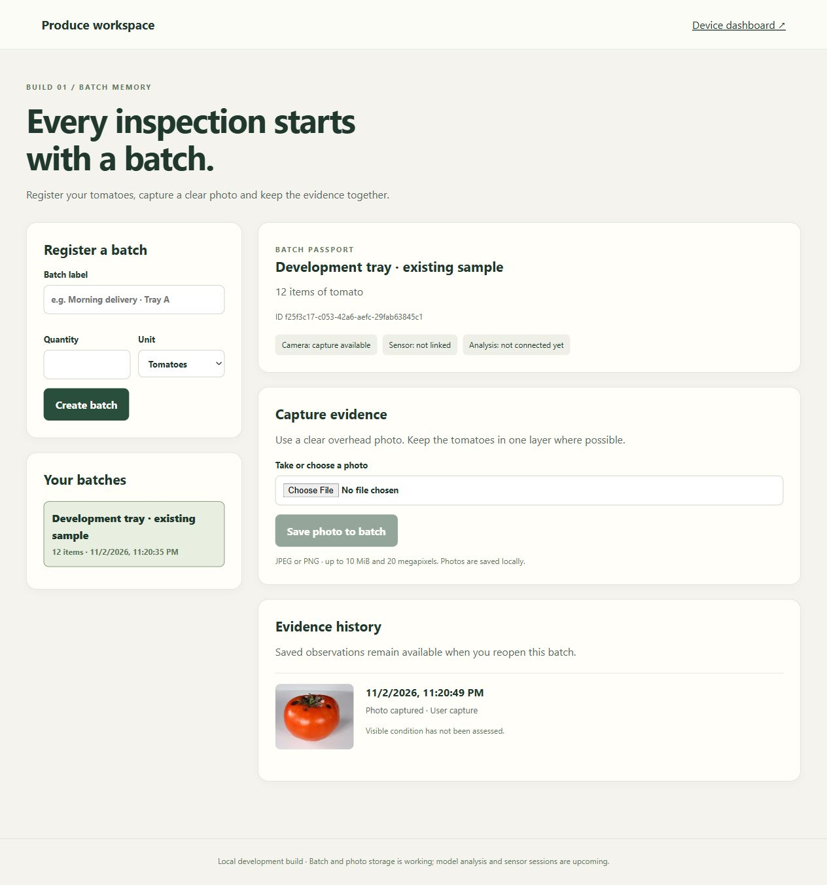
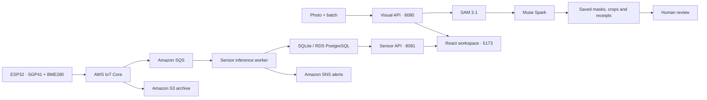

# FreshTrace · Produce Inspection Workspace

**Turn produce photos and sensor readings into evidence for a closer inspection.**

Built for the [Meta AI Developer Hackathon](https://cerebralvalley.ai/events/~/e/meta-ai-developer-hackathon), FreshTrace combines Meta visual models, persistent batch history, human review, and an AWS sensor pipeline.



## What you can do

- **Inspect a batch:** register tomatoes, capture or upload a photo, and reopen its evidence history.
- **Explore visual evidence:** SAM 3.1 locates individual tomatoes; Muse Spark describes visible concerns and visibility limits. Select a region to inspect its crop, findings, and model receipts.
- **Record a review:** confirm or correct an observation while retaining the original model result.
- **Monitor a sensor node:** inspect temperature, humidity, VOC/NOx signals, recorded trends, risk estimates, and online status. Select among devices that have submitted telemetry.
- **Receive alerts:** enable browser notifications or configure Amazon SNS email/SMS subscriptions.
- **Explore the model lab:** replay the recorded Voice → SAM → Spark → Wonder workflow with its evidence and receipts.

## Dashboards and ports

| Interface | Open in your browser | Start command, from the repository root |
| --- | --- | --- |
| **Build 2 · Visual inspection workspace** | [127.0.0.1:5173](http://127.0.0.1:5173/) | Product API below + frontend |
| **Build 1 · Sensor dashboard** | [127.0.0.1:5173/?view=device](http://127.0.0.1:5173/?view=device) | Sensor API below + frontend |
| **Model testing lab · recorded replay** | [127.0.0.1:8767](http://127.0.0.1:8767/) | `python scripts/smoke/preview_video_site.py --directory demos/video-model-flow` |
| **Visual inspection API / interactive docs** | [127.0.0.1:8080/docs](http://127.0.0.1:8080/docs) | `python scripts/run_product.py` |
| **Sensor API / interactive docs** | [127.0.0.1:8081/docs](http://127.0.0.1:8081/docs) | `python scripts/run_product.py --mode sensor` |

The two dashboards share one frontend. Each API runs separately, so both dashboards can be used at the same time. Commands in this table assume your virtual environment is activated; the Windows commands below also work without activation.

## Quick start · Windows PowerShell

Use **Python 3.12 or 3.13**, **Node.js 22.17 or later**, npm, and Git. Run these commands from the repository root:

```powershell
python -m venv .venv
.venv\Scripts\python.exe -m pip install -e ".[dev,models]"
if (!(Test-Path .env)) { Copy-Item .env.example .env }
npm --prefix frontend ci
```

Open `.env` and paste your Meta key after `MODEL_API_KEY=`. The same key serves the Meta model integrations. AWS values can stay blank for visual inspection. Keep credentials on the server; `.env` is excluded from Git.

**Terminal 1 — visual inspection API:**

```powershell
.venv\Scripts\python.exe scripts/run_product.py
```

**Terminal 2 — frontend:**

```powershell
cd frontend
npm run dev
```

Open **http://127.0.0.1:5173/**. Create a batch, save a JPEG/PNG photo or import a public sample, then choose **Analyse tomatoes**. This action submits the photo to Meta. Viewing saved results and recording reviews reuse stored evidence.

For the sensor dashboard, install its optional dependencies and start a third terminal:

```powershell
.venv\Scripts\python.exe -m pip install -e ".[cloud]"
.venv\Scripts\python.exe scripts/run_product.py --mode sensor
```

See the **[complete setup guide](docs/setup.md)** for macOS/Linux commands, hardware, AWS, environment variables, startup checks, and troubleshooting.

## How it fits together



Visual inspection stores batches, photos, model jobs, and reviews in SQLite and local media by default. The sensor service can use local SQLite or Amazon RDS. AWS IoT routes incoming telemetry to SQS for processing and S3 for archiving; SNS delivers configured threshold alerts.

The current product workspace runs SAM/Spark on photos. The model lab presents recorded four-model results, including voice transcription and Wonder planning. Visual findings and sensor estimates support inspection; they do not establish food safety.

## Development and verification

```powershell
.venv\Scripts\python.exe -m pytest tests -q --basetemp=tmp/verification
npm --prefix frontend run build
npm --prefix frontend run lint
```

The automated suite uses temporary databases, local files, and controlled provider responses. Live Meta validation and AWS deployment are separate, explicit operations.

## Documentation

| Guide | Contents |
| --- | --- |
| [Setup](docs/setup.md) | Every service, port, command, environment variable, and troubleshooting step |
| [Visual inspection](docs/visual_prototype.md) | Model jobs, item picking, reviews, and saved evidence |
| [Architecture](docs/repository_architecture.md) | Runtime boundaries, persistence, hardware, and source map |
| [Model validation](docs/model_validation.md) | Recorded provider checks and reproducible evidence |
| [Model lab](demos/video-model-flow/README.md) | Local replay, source attribution, and recorded results |
| [Repository audit](docs/repository_audit.md) | Audit scope, repairs, verification, and deployment boundaries |
| [Product roadmap](docs/phased_implementation_plan.md) | Planned investigation and stock workflow |

Public sample images retain their authorship and license information in the [sample manifest](data/fixtures/tomato_images/manifest.json). Video attribution and reuse terms are in the [model lab guide](demos/video-model-flow/README.md). Run the development APIs on loopback; public deployment requires authentication and access controls.
