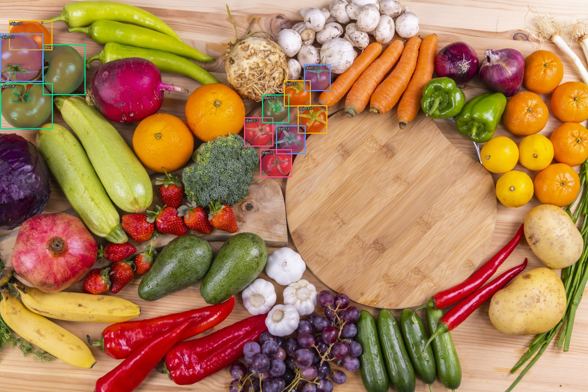

# Hosted model validation

Date: 1 November 2026 (IST). Branch: `codex/meta-model-validation`.

## Result

The supplied team key authenticated against Meta Model API. Muse Spark, SAM 3.1
and Muse Wonder returned real completed responses. These are hosted API models:
no local weights or GPU server were loaded. The SDK, image handling, parser and
adapter code are installed/tested locally in the ignored `.venv` environment.

| Check | Result | Evidence |
| --- | --- | --- |
| Spark text | PASS, 2.77 seconds in adapter validation | Exact expected access-check answer |
| Spark structured vision | PASS, 12.33 seconds | JSON-schema response validated by Pydantic; produce types, visible observations and visibility limits |
| SAM image segmentation | PASS, 4.24 seconds | 11 nonempty tomato masks decoded; no parser diagnostics; image-aligned overlay visually inspected |
| Wonder read-only planning | PASS, 18.42 seconds including two calls | Real `get_batch_history` tool call, fixture tool result returned to model, completed final plan |
| Offline boundary suite | PASS | 13 tests: orientation, masked keys, input shape, incomplete/malformed/empty segmentation, vision schema and planner constraints |

These timings are single observations, not performance percentiles or guarantees.
The checks passed across two adapter-validation runs; only the failed planner
check was rerun after its compatibility fix. Initial simple text/vision/planning
access checks were also successful.

## Visual segmentation result



Source image: `frontend/src/assets/fresh_vegetables_bg.jpg` (1600 x 1067).
SAM received the prompt `tomato`. The masks align with the visible large and small
tomatoes in this example. There is no independently annotated ground-truth mask
set, so this is an integration/visual sanity check, not an accuracy benchmark.
Image orientation is normalized before upload so rendering uses the same pixels.

## Compatibility issue found and resolved

The initial Wonder tool call was rejected with HTTP 400 because this endpoint
supports only `tool_choice="auto"`. It does not support `"required"` or a named
forced choice. The adapter now uses `auto` and independently requires at least one
successful allowlisted history lookup before accepting a final plan.

`src/backend/meta/planner.py` validates the exact tool name and batch ID, returns
the tool result, preserves reasoning/output items across turns and stops after at
most three model turns. It has no write or hardware-control tools. The real
response proposed taking a photo, characterizing the missing protocol and seeking
human inspection. It did not claim those tasks had happened.

The history in this check comes from
`data/fixtures/meta_planning_batch.json`, explicitly marked synthetic. The model
call is real; the batch database and device interaction are not implemented by
this fixture. A prior unconstrained planning prompt suggested timing/procedure
without a characterized protocol. The tested adapter now provides explicit
protocol constraints; application code must continue to enforce those constraints.

## Files ready for application integration

- `src/backend/meta/client.py`: client factory, image normalization and request shape.
- `src/backend/meta/vision.py`: typed, validated appearance observations.
- `src/backend/meta/segmentation.py`: strict parsing, per-object masks and overlay.
- `src/backend/meta/planner.py`: bounded read-only history-tool integration.
- `scripts/smoke/validate_meta_models.py`: opt-in live adapter-validation suite.
- `scripts/smoke/meta_models.py`: individual basic access checks.
- `tests/unit/test_meta_integration.py`: offline boundary tests.
- [Machine-readable results](validation/meta_model_results.json): response IDs,
  actual usage, tool trace, successful observations and the resolved rejection.

No API key is stored in these files. Authentication is supplied with
`MODEL_API_KEY` or a hidden terminal prompt. The key pasted into chat should be
rotated after this validation; use the replacement locally in the same way.
Full raw responses stay in ignored `tmp/`, outside source control. The committed
results contain the inspected repo image and synthetic test history, not vendor data.

## Reproduce

Use Python 3.12, from the repository root:

```powershell
python -m venv .venv
.\.venv\Scripts\python.exe -m pip install -r scripts/smoke/requirements.txt
.\.venv\Scripts\python.exe scripts/smoke/validate_meta_models.py --live
```

Enter the full key at the hidden prompt. Or set it privately for the current shell:

```powershell
$env:MODEL_API_KEY = [System.Net.NetworkCredential]::new("", (Read-Host "Meta API key" -AsSecureString)).Password
```

Run offline tests without a key:

```powershell
.\.venv\Scripts\python.exe -m pytest tests/unit/test_meta_integration.py -q
```

In a sandbox that cannot write system temporary directories, give pytest a **new**
directory under this repository with `--basetemp`; pytest may clear an existing
base-temp directory, so do not point it at a source or shared data directory.

Validated versions: openai 2.54.0, meta-sam-parser 0.1.0, Pillow 13.0.0, Pydantic
2.14.2 and pytest 8.4.2. SDK/parser/image dependencies are pinned in the standalone
requirements and the `models` package extra. No automatic API retry is enabled.

## Usage and cost

Across the initial checks and adapter validation, 9 successful inference responses
were recorded, plus one rejected request for the incompatible tool-choice setting.
The successful SAM calls processed one image each. Summing recorded token/image
usage at the published standard rates gives approximately **US $0.12**. This is an
estimate, not a billing receipt; check the credited team's Usage/Billing dashboard
for the authoritative credit deduction. Planning can use more than one model call.

## What is not validated yet

No live sensor session, repeatability gate, food-quality classifier, safety
probability, vendor outcome, long-term early-warning result, production database
tool, product endpoint or frontend workflow was validated here. Existing AWS
deployment and firmware were not changed. Optional voice/image-generation models
were not needed for this validation.

Next build slice: batch identity and persistence -> real photo upload -> these
SAM/Spark adapters -> evidence timeline -> valid sensor-session attachment ->
inspection-priority policy -> bounded planning and human-confirmed action.

## Documentation used

- [Meta quickstart](https://dev.meta.ai/docs/quickstart)
- [Image input and understanding](https://dev.meta.ai/docs/image-understanding)
- [SAM client libraries](https://dev.meta.ai/docs/sam/client-libraries)
- [Published model pricing](https://dev.meta.ai/docs/pricing-rate-limits)
